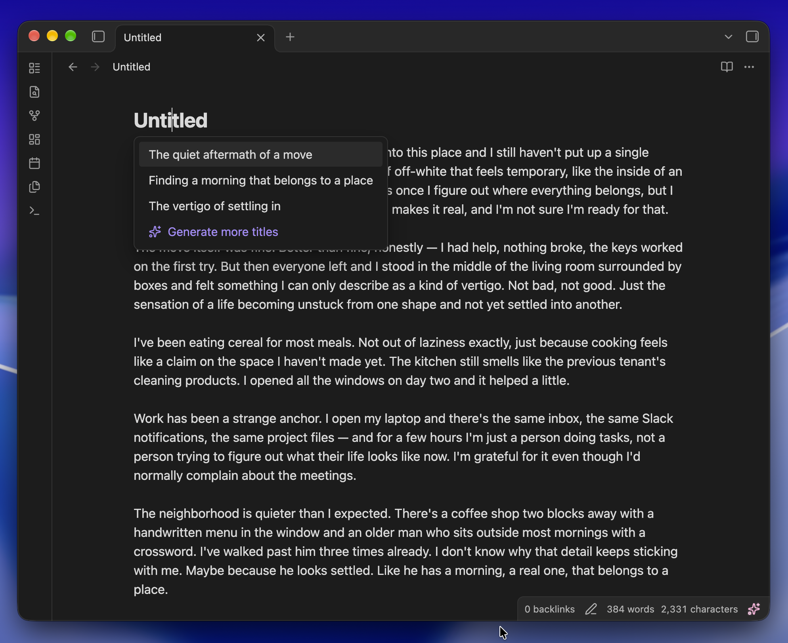

# Titler
Suggest titles for you notes automatically, all on-device.

## Privacy and network use

Your notes never leave your device: titles are generated locally, with no account, API key or
external service.

The plugin uses the network once, to download what it runs:

- the AI model ([Qwen3.5 2B](https://huggingface.co/onnx-community/Qwen3.5-2B-ONNX-OPT), about
  1.4 GB) from **huggingface.co**, which starts when you enable the plugin (you can put it off from
  the notice and start it later from the settings);
- the ONNX Runtime files that run it, from **cdn.jsdelivr.net**.

Both are stored in Obsidian's own storage on that device, shared by all your vaults, and work
offline after that. There is no telemetry. **Report a bug** in the settings opens a GitHub issue in
your browser, which you can read and edit before sending; it never includes your notes.

## Settings

- **Name untitled notes automatically**: on by default.
- **Capitalization**: Sentence case, Title Case or lowercase.
- **Length**: short (2–4 words), medium (4–8) or descriptive (up to 12).
- **Style**: a topic ("Sourdough starter care"), a claim ("Starters need daily feeding at room
  temperature") or a question ("How often should I feed a starter").

Under **Advanced** you can turn the AI off on one device, choose how long the model stays in
memory after use on that device, change how much you need to have written before a note is
named, and delete the downloaded model.

## Requirements

- Obsidian 1.13 or later, on desktop. The model is too large for phones and tablets.
- About 1.5 GB of disk space for the model, and as much memory while it's loaded. It unloads
  after 10 minutes without use (adjustable under **Advanced**) and reloads in a few seconds when
  needed.
- A GPU with WebGPU support makes a title take about a second. Without one, the plugin runs on the
  CPU, which works but is noticeably slower.

## License

The model, Qwen3.5 2B, is licensed under Apache 2.0.
